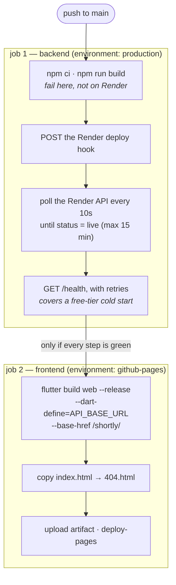

# Deployment

How Shortly gets to production, how to set it up from scratch, and what to do when a deploy
fails. If you are only changing code, you do not need this file: **push to `main` and the
pipeline does the rest.** Read on when you are setting up a new environment, rotating a
credential, or debugging a red build.

| | Hosted on | Live URL | Deployed by |
|---|---|---|---|
| Backend (API + redirects) | Render (free tier) | <https://shortly-dgxi.onrender.com> | Deploy hook, from CI |
| Frontend (Flutter web) | GitHub Pages | <https://moyeenhaider3.github.io/shortly/> | `actions/deploy-pages`, from CI |
| Database | MongoDB Atlas | — | Managed separately; not part of the pipeline |

---

## How the pipeline works

A push to `main` runs [`.github/workflows/deploy.yml`](.github/workflows/deploy.yml). The two
jobs run **in sequence**, not in parallel:



Three design decisions worth knowing:

- **The frontend waits for the backend** (`needs: backend`). The app is never published
  against a backend that failed to start. If Render breaks, Pages keeps serving the last
  good build.
- **The backend is compiled twice** — once in CI and once on Render. The CI build is a fast
  gate so a type error fails in ~40 seconds with a readable log, instead of after a full
  Render deploy cycle.
- **Deploys never overlap.** `concurrency: production-deploy` with
  `cancel-in-progress: false` queues a second push rather than cancelling a half-finished
  deploy.

---

## First-time setup

Do these in order. Each step ends with a way to check it worked before you move on.

### 1. Database — MongoDB Atlas

Render has no database of its own, and `127.0.0.1` from your `.env` means nothing there.

- Create a free **M0** cluster at <https://cloud.mongodb.com>.
- **Database Access** → add a user with a generated password. Save it.
- **Network Access** → add `0.0.0.0/0`. Render's free tier has no fixed outbound IP, so
  there is nothing narrower to allow-list.
- Copy the connection string and append the database name:

  ```
  mongodb+srv://<user>:<password>@<cluster>.mongodb.net/url_shortener_db?retryWrites=true&w=majority
  ```

> **Verify:** `mongosh "<your connection string>"` connects from your machine.

### 2. Render web service

New → **Web Service** → connect this repository.

| Setting | Value |
|---|---|
| Root Directory | `backend` |
| Build Command | `npm ci --include=dev && npm run build` |
| Start Command | `npm start` |
| Health Check Path | `/health` |
| Auto-Deploy | **Off** |
| Instance Type | Free |

Then add the environment variables:

| Variable | Value |
|---|---|
| `MONGODB_URI` | The Atlas string from step 1 |
| `JWT_SECRET` | A long random string — `openssl rand -base64 32` |
| `JWT_EXPIRES_IN` | `7d` |
| `NODE_ENV` | `production` |

> **Do not set `PORT`.** Render assigns it and injects it; overriding it makes the health
> check fail because the app listens on the wrong port.

Two settings above are easy to get wrong, and both have cost someone an hour:

- **`--include=dev` is not optional.** `NODE_ENV=production` tells npm to skip
  `devDependencies`, and `typescript` is one, so a plain `npm ci` builds nothing and then
  fails with `tsc: not found`.
- **Auto-Deploy must be off.** The workflow triggers deploys through the hook. Leaving
  auto-deploy on makes every push deploy twice, and the two deploys race.

> **Verify:** the first deploy reaches **Live**, and
> `curl https://<your-service>.onrender.com/health` returns `"success":true`.
> That proves the server is up — it does **not** prove Atlas is reachable, because the app
> starts listening before Mongo connects. For that, hit a route that reads the database:
>
> ```bash
> curl https://<your-service>.onrender.com/api/urls/check/probe-123
> # {"success":true,"data":{"alias":"probe-123","available":true}}   ← Mongo is connected
> ```
>
> A hang or a 500 here means `MONGODB_URI` is wrong or Atlas is blocking the IP.

### 3. Collect three values from Render

| Value | Where |
|---|---|
| Deploy Hook URL | Service → Settings → **Deploy Hook** (`https://api.render.com/deploy/srv-…?key=…`) |
| Service ID | The `srv-…` on the service page, also in the browser URL |
| API Key | Account Settings → **API Keys** → Create |

The deploy hook URL is a credential: anyone holding it can trigger a deploy. The API key is
broader still — it is account-wide, not scoped to this one service. Treat both like
passwords and never paste them into the repo, an issue, or a chat.

### 4. GitHub — environment and secrets

**Settings → Environments → New environment**, named exactly `production`.

- Under **Deployment branches**, choose *Selected branches* and add `main`. This is what
  stops a branch or a fork from reaching these credentials.
- Add three **environment secrets**:

| Secret | Value from step 3 |
|---|---|
| `RENDER_DEPLOY_HOOK_URL` | The full hook URL, including `?key=…` |
| `RENDER_API_KEY` | The API key |
| `RENDER_SERVICE_ID` | `srv-…` |

### 5. GitHub — the backend URL variable

**Settings → Secrets and variables → Actions → _Variables_ tab** → New repository variable.

| Name | Value |
|---|---|
| `BACKEND_URL` | `https://<your-service>.onrender.com` |

No `/api` suffix and no trailing slash — the workflow appends `/api` itself.

> **This is a _variable_, not a secret.** They are two separate tabs on the same page, and
> putting it in the wrong one is the single most common setup mistake here. The workflow
> reads `vars.BACKEND_URL`; a *secret* of the same name is invisible to it and the run
> fails with `Repository variable BACKEND_URL is not set`.
>
> It is deliberately not a secret. The URL is compiled into the public JavaScript bundle
> and is visible to anyone who opens the site, so hiding it would buy nothing while making
> build logs harder to read.

It is a **repository** variable rather than an environment one because both jobs read it,
and the frontend job runs in the `github-pages` environment, which cannot see
`production`'s values.

### 6. GitHub Pages

**Settings → Pages → Source → GitHub Actions.**

Nothing else. In particular there is no token to create: `deploy-pages` authenticates with
OIDC using the `id-token: write` permission the job grants itself.

### 7. First run

**Actions → Deploy → Run workflow.** You do not need a new commit.

> **Verify:** both jobs are green, <https://moyeenhaider3.github.io/shortly/> loads, and you
> can sign up and create a link. Then open DevTools → Network and confirm the XHR requests
> go to `onrender.com` and not to `localhost:5000`.

---

## Credentials reference

Everything the pipeline needs, and where each one lives:

| Name | Kind | Scope | Used by | Rotate at |
|---|---|---|---|---|
| `RENDER_DEPLOY_HOOK_URL` | Secret | `production` env | Trigger step | Render → Settings → Deploy Hook → Regenerate |
| `RENDER_API_KEY` | Secret | `production` env | Poll step | Render → Account Settings → API Keys |
| `RENDER_SERVICE_ID` | Secret | `production` env | Poll step | Not a credential; changes only if the service is recreated |
| `BACKEND_URL` | **Variable** | Repository | Both jobs | Change when the Render URL changes |
| `MONGODB_URI` | Render env var | Render only | Runtime | Atlas → Database Access |
| `JWT_SECRET` | Render env var | Render only | Runtime | Rotating it logs every user out |

Nothing secret is given to the Flutter build. The only value injected into the client is
`BACKEND_URL`, which is public by nature.

---

## Everyday operations

**Deploy:** push to `main`. That is the whole procedure.

**Redeploy without a code change:** Actions → Deploy → Run workflow. Use this after
changing an environment variable on Render, since a variable change alone does not restart
the app with a fresh build.

**Roll back:** Render → service → **Events** (or Deploys) → find the last good deploy →
**Redeploy**. This rolls back the backend only. For the frontend, revert the commit and
push; Pages always serves the most recent successful build.

**Deploy the backend by hand**, bypassing CI:

```bash
curl -X POST "$RENDER_DEPLOY_HOOK_URL"
```

**Change the backend URL** (for example after renaming the Render service): update the
`BACKEND_URL` repository variable, then re-run the workflow. The frontend must be rebuilt,
because the URL is compiled in at build time — changing the variable alone does nothing
until a new build runs. Also grep the repo, as the URL appears in the READMEs:

```bash
grep -rn "shortly-dgxi" --include="*.md" .
```

---

## Troubleshooting

Each of these has actually happened on this project.

### `npm error code EBADPLATFORM` during the Render build

```
Unsupported platform for @typescript/typescript-darwin-arm64@7.0.2:
wanted {"os":"darwin","cpu":"arm64"} (current: {"os":"linux","cpu":"x64"})
```

A macOS-only package reached `package.json`, usually because an editor or an `npm install`
on an Apple Silicon machine added a platform-specific binary as a direct dependency. Render
and GitHub runners are Linux, so `npm ci` refuses to install it.

```bash
cd backend && npm uninstall @typescript/typescript-darwin-arm64
```

Commit the updated `package.json` **and** `package-lock.json`. If you see this for another
package, the fix is the same: it belongs in `optionalDependencies`, or nowhere.

### `sh: 1: tsc: not found` during the Render build

The build command is missing `--include=dev`. See step 2.

### `Error: Repository variable BACKEND_URL is not set`

`BACKEND_URL` is missing, misspelled, or was added as a *secret* instead of a *variable*.
See step 5. It must also be a **repository** variable, not an environment one, or the
frontend job cannot read it.

### `Deploy hook did not return a deploy id`

The hook responded, but not with the `{"deploy":{"id":"dep-…"}}` shape the workflow expects.
Check that `RENDER_DEPLOY_HOOK_URL` is the complete URL including `?key=…` — a truncated
copy-paste returns an error body instead. To see what the hook actually returns:

```bash
curl -i -X POST "$RENDER_DEPLOY_HOOK_URL"
```

If Render has changed the response shape, adjust the `jq` filter on
[`deploy.yml:52`](.github/workflows/deploy.yml#L52).

### `Render deploy ended with status 'build_failed'`

CI compiled the code fine but Render did not. The difference is almost always environment:
CI runs `npm ci` with no `NODE_ENV`, while Render runs with `NODE_ENV=production`, which
skips `devDependencies`. Open the Render build log for the real error.

### The job hangs on `Wait for deploy to go live`, then times out

A free instance that is spinning up from cold can take a few minutes. The workflow allows
15. If it consistently times out, check the Render log for a crash loop — commonly a bad
`MONGODB_URI`, or `PORT` set manually.

### The deployed app calls `localhost:5000`

The web build ran without `--dart-define=API_BASE_URL`, so it fell back to the dev default.
Re-run the workflow. If it persists, confirm the frontend job's log shows the flag with a
real URL. To check a local build:

```bash
cd frontend && grep -c "localhost:5000" build/web/main.dart.js   # expect 0 for a prod build
```

### Short links come back as `http://` instead of `https://`

[`backend/src/app.ts`](backend/src/app.ts) is missing `app.set('trust proxy', 1)`. Render
terminates TLS at its proxy and forwards over plain HTTP, so without that line
`req.protocol` reads `http` and every generated link is built with the wrong scheme. The
links still work — Render redirects — but they look insecure when copied and cost a
redirect.

### CORS errors in the browser console

[`app.ts`](backend/src/app.ts) sends `Access-Control-Allow-Origin: *`. Note that the spec
forbids pairing a wildcard with credentialed requests, so browsers drop the `token` cookie
that login sets. This is harmless today because the Flutter client authenticates with the
`Authorization: Bearer` header and ignores the cookie. If you ever need the cookie to work
in a browser, replace the wildcard with an explicit list:

```ts
origin: ['http://localhost:8080', 'https://moyeenhaider3.github.io'],
```

### A page 404s when refreshed, but works when navigated to

The app uses the path URL strategy, so `/links/abc` is a real path as far as Pages is
concerned. The workflow handles this by copying `index.html` to `404.html`, which makes
Pages serve the app for unknown paths. If this regresses, check that step still runs.

### Everything is green but the site is blank

Almost always a `--base-href` mismatch. Pages serves this repo from `/shortly/`, so the
build must set `--base-href /shortly/`. The workflow derives it from the repository name,
so renaming the repo fixes itself on the next deploy — but a custom domain serving from the
root would need the base href changed to `/`.

### The first request after a quiet period takes 30–60 seconds

Expected. Render's free tier spins an idle service down after about 15 minutes, and the next
request pays for the wake-up. Subsequent requests are fast. Note that Dio's 10-second
`connectTimeout` in [`api_client.dart`](frontend/lib/core/network/api_client.dart) can fire
during a cold start; raise it, or move off the free tier, if that becomes a real problem.

---

## Setup checklist

```
Atlas
  [ ] M0 cluster created
  [ ] database user created, password saved
  [ ] network access allows 0.0.0.0/0
  [ ] connection string ends with /url_shortener_db

Render
  [ ] web service created from this repo
  [ ] root directory      = backend
  [ ] build command       = npm ci --include=dev && npm run build
  [ ] start command       = npm start
  [ ] health check path   = /health
  [ ] auto-deploy         = OFF
  [ ] env: MONGODB_URI, JWT_SECRET, JWT_EXPIRES_IN, NODE_ENV=production
  [ ] PORT is NOT set
  [ ] /health returns success
  [ ] /api/urls/check/probe returns success  (proves Mongo is connected)

GitHub
  [ ] environment "production" exists, limited to branch main
  [ ] secret   RENDER_DEPLOY_HOOK_URL
  [ ] secret   RENDER_API_KEY
  [ ] secret   RENDER_SERVICE_ID
  [ ] VARIABLE BACKEND_URL  (Variables tab, repository scope, no trailing slash)
  [ ] Pages source = GitHub Actions

Verify
  [ ] workflow run is green end to end
  [ ] site loads at the Pages URL
  [ ] sign-up and link creation work
  [ ] DevTools shows requests going to onrender.com, not localhost
  [ ] a created short link opens and increments its click count
```
