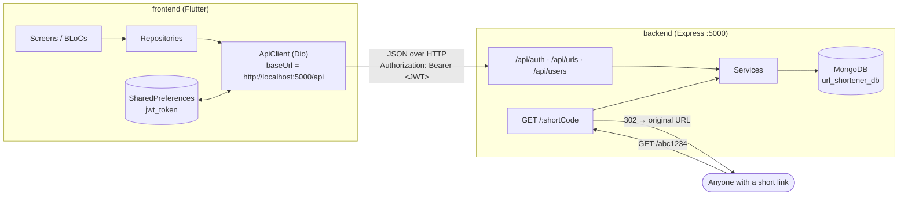
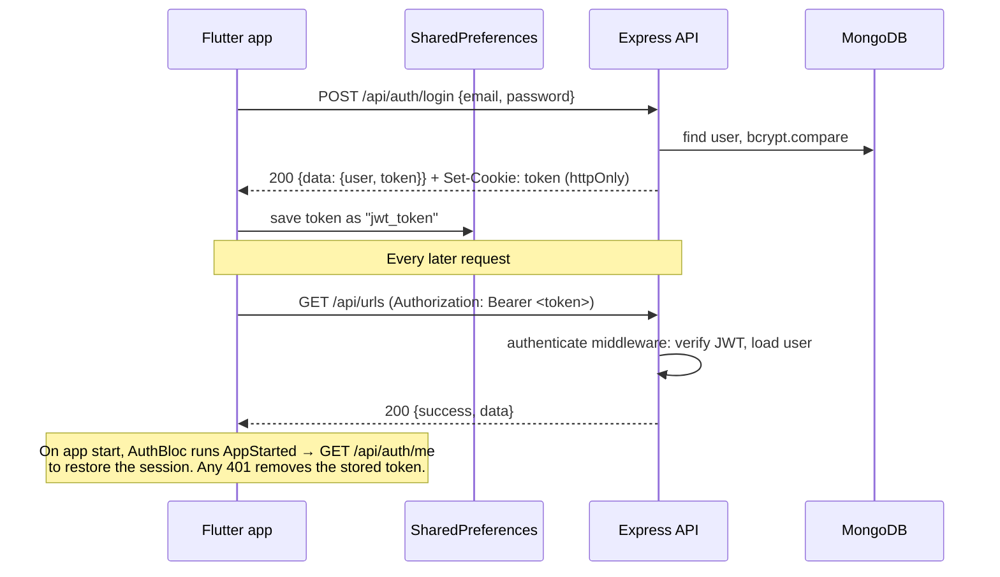

# Shortly — URL Shortener

Shortly shortens links, lets you pick a custom alias, and counts every click. It has two parts:

| Part | Folder | Stack | Runs on | Docs |
|---|---|---|---|---|
| **Backend** (API + redirects) | [`backend/`](backend/) | Node.js, TypeScript, Express 5, MongoDB (Mongoose), JWT | `http://localhost:5000` | [Backend README](backend/README.md) |
| **Frontend** (dashboard app) | [`frontend/`](frontend/) | Flutter (web first; mobile and desktop also build), BLoC, Dio, go_router | `http://localhost:8080` (web) | [Frontend README](frontend/README.md) |

This file explains how the two parts fit together. Setup, structure and API details for each part are in its own README.

---

## Architecture



There are two separate kinds of traffic:

1. **The app talking to the API.** The Flutter app calls `/api/*` on the backend to log in and to manage links, users and analytics.
2. **Visitors opening short links.** A short link such as `http://localhost:5000/abc1234` goes **straight to the backend**, not to the Flutter app. The backend records the visit and sends back a `302` redirect to the original URL.

---

## How the frontend connects to the backend

### 1. Base URL

The API address is set in one place: [`frontend/lib/core/network/api_client.dart`](frontend/lib/core/network/api_client.dart)

```dart
static const String baseUrl = 'http://localhost:5000/api';
```

Every repository builds its request paths on top of this, for example `'/urls'` becomes `http://localhost:5000/api/urls`. If you move the backend to another host or port, change this constant. The backend port comes from `PORT` in `backend/.env` and defaults to `5000`.

> **Android emulator:** inside the emulator, `localhost` means the emulator itself. Use `http://10.0.2.2:5000/api` there. On a physical device, use your machine's LAN IP.

### 2. Authentication (JWT)



- The backend sends the JWT back in **two** ways: in the response body (`data.token`) and in an `httpOnly` cookie named `token`.
- The Flutter app uses the **body token**. It saves it in `SharedPreferences` and a Dio interceptor adds `Authorization: Bearer <token>` to every request.
- The backend's [`authenticate`](backend/src/middlewares/auth.middleware.ts) middleware looks for the cookie first and falls back to the `Bearer` header, so both ways work.
- On a `401`, the client deletes the stored token. The router then sends the user back to `/login`.

### 3. CORS

[`backend/src/app.ts`](backend/src/app.ts) enables CORS with `origin: true` (it accepts any origin) and `credentials: true`. It allows the `Content-Type` and `Authorization` headers and the methods `GET, POST, PATCH, DELETE, OPTIONS`. This is why Flutter web on `localhost:8080` can call the API on `localhost:5000`. **Restrict `origin` before deploying.**

### 4. Response format

Every API response uses the same envelope, and the client parses it the same way everywhere:

```jsonc
// success
{ "success": true, "data": { ... }, "message": "optional", "count": 3 /* list endpoints only */ }

// error
{ "success": false, "message": "Human readable text", "code": "MACHINE_CODE" }
```

On the client, repositories read `response.data['data']`. `ApiClient.getErrorMessage()` takes the `message` field from error responses, and that text is what the user sees in toasts and inline alerts.

### 5. Endpoint map: who calls what

| Backend endpoint | Auth | Used by the client in |
|---|---|---|
| `POST /api/auth/signup` | public | `AuthRepository.signup` → Sign-up screen |
| `POST /api/auth/login` | public | `AuthRepository.login` → Login screen |
| `POST /api/auth/logout` | user | `AuthRepository.logout` → user menu |
| `GET  /api/auth/me` | user | `AuthRepository.getCurrentUser` → session restore on startup |
| `GET  /api/urls/check/:alias` | public | `UrlRepository.checkAliasAvailability` → live alias check on the Dashboard |
| `POST /api/urls` | user | `UrlRepository.createUrl` → "Create link" panel |
| `GET  /api/urls` | user | `UrlRepository.getUrls` → Dashboard, Links, Analytics overview |
| `GET  /api/urls/:id` | owner / admin | `UrlRepository.getUrlById` → link detail |
| `GET  /api/urls/:id/analytics` | owner / admin | `UrlRepository.getUrlAnalytics` → `/links/:id` analytics screen |
| `PATCH /api/urls/:id` | owner / admin | *not used by the client yet* |
| `DELETE /api/urls/:id` | owner / admin | `UrlRepository.deleteUrl` → "Deactivate" (soft delete) |
| `GET  /api/users` | admin | `UserRepository.getUsers` → `/users` screen |
| `POST /api/users` | admin | `UserRepository.createUser` → "Add user" dialog |
| `GET  /:shortCode` | public | not called by the app. Visitors open it directly, and the app shows and copies `shortUrl` |
| `GET  /health` | public | not called by the app. Use it to check the server is up |

### 6. Short URLs

The backend builds each link's `shortUrl` from the incoming request's protocol and `Host` header (`http://localhost:5000/<shortCode>`). The client never builds short URLs itself. It displays, copies and turns into a QR code whatever `shortUrl` the API returns. Because the URL comes from the request, behind a proxy or on a different host the links follow whatever host the client called.

### 7. Roles

| Role | How you get it | What it can do |
|---|---|---|
| `NORMAL` | Public sign-up (always `NORMAL`, even if the request asks for another role) | Manage and see analytics for **their own** links |
| `ADMIN` | Created by another admin through `POST /api/users` | Everything above, plus view, update or delete any link by id and manage users |

The backend enforces roles with [`restrictTo`](backend/src/middlewares/role.middleware.ts) and ownership checks. The client also hides `/users` from non-admins in [`app_router.dart`](frontend/lib/core/router/app_router.dart), but that is only so they don't land on a page that would fail. The backend check is what actually protects the data.

**Creating the first admin:** no endpoint can create the first admin. Sign up normally, then promote that user in MongoDB:

```js
// mongosh
use url_shortener_db
db.users.updateOne({ email: "you@example.com" }, { $set: { role: "ADMIN" } })
```

---

## Quick start (run both)

**You need:** Node.js 18+, MongoDB running locally on `27017`, and Flutter with Dart SDK `^3.13.2`.

```bash
# 1. Backend: terminal 1
cd backend
cp .env.example .env          # then set JWT_SECRET
npm install
npm run dev                   # → 🚀 Server running ... on port 5000
                              # → 🍃 MongoDB Connected: 127.0.0.1

# 2. Check it is up
curl http://localhost:5000/health

# 3. Frontend: terminal 2
cd frontend
flutter pub get
flutter run -d chrome --web-port=8080
```

Then open `http://localhost:8080`, sign up, and create a link. Opening the short link in a new tab redirects you and adds a click.

In VS Code you can also use the launch configurations in [`frontend/.vscode/launch.json`](frontend/.vscode/launch.json), for example **"Flutter Web (Chrome) + peek"**.

---

## Troubleshooting connection issues

| What you see | Likely cause | Fix |
|---|---|---|
| `Network connection error` / `connection refused` in the app | Backend not running, or the port doesn't match | Start the backend. Make sure `PORT` in `.env` matches `ApiClient.baseUrl` |
| Requests take about 10 s and then fail | Backend is up but MongoDB isn't. The server stays up (so `/health` still works), but Mongoose holds database queries until they time out | Start MongoDB and check `MONGODB_URI` |
| CORS error in the browser console | `cors` options in `app.ts` changed, or a custom header was added on the client | Add the header to `allowedHeaders` or the method to `methods` |
| App keeps returning to `/login` | Token expired (`JWT_EXPIRES_IN`), or `JWT_SECRET` changed so old tokens no longer verify | Log in again |
| Works in Chrome, fails on the Android emulator | `localhost` points at the emulator itself | Use `10.0.2.2` in `baseUrl` |
| Short link returns a `404` JSON error | Link was deactivated (soft deleted) or the code is wrong | Deactivated links stop redirecting on purpose |

For debugging the running Flutter app (console and HTTP logs), see [Debugging in the frontend README](frontend/README.md#debugging).

---

## More detail

- **[Backend README](backend/README.md):** environment variables, full API reference with request and response examples, data model, error codes, and project structure.
- **[Frontend README](frontend/README.md):** screens, state management, routing, folder structure, theming, tests, and debugging.
