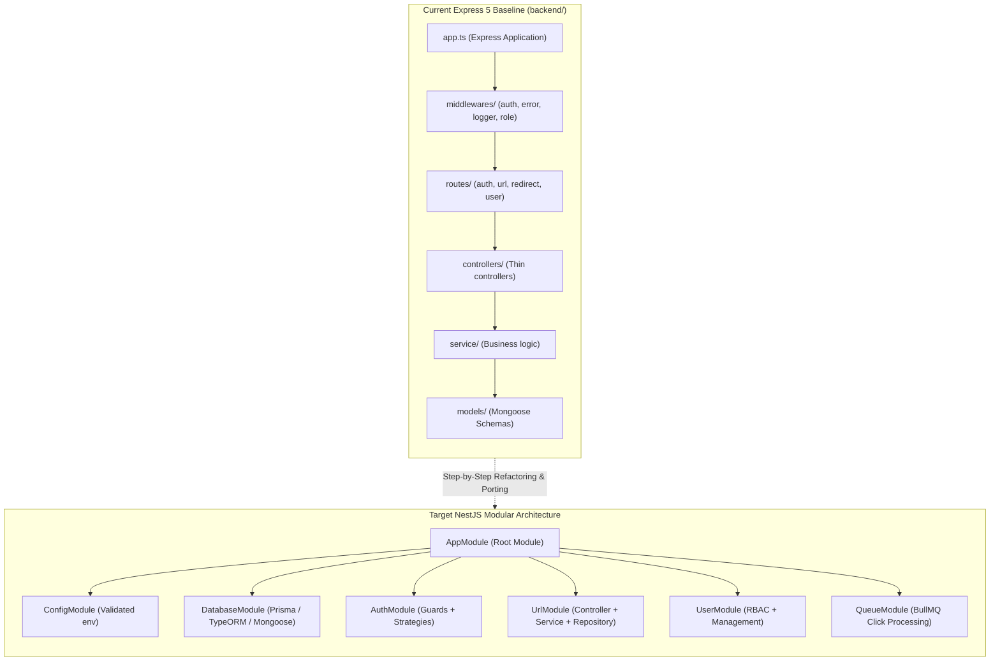

# 🚀 10-Day NestJS Backend Development Roadmap & Progress Tracker

Welcome to the comprehensive, hands-on learning roadmap for mastering modern backend engineering with **NestJS, TypeScript, and Node.js**. 

This roadmap connects theoretical backend fundamentals with real-world production engineering, using our project **Shortly** (a production URL shortener and analytics system) as the live baseline.

---

## 📊 Overall Roadmap Status & Progress Dashboard

| Day | Module / Topic | Status | Existing Shortly Coverage | Remaining NestJS Target | Daily Guide |
|:---:|:---|:---:|:---|:---|:---:|
| **Day 1** | **Node.js Fundamentals & NestJS Architecture** | 🟡 In Progress (60%) | Express 5, TypeScript strict mode, basic `dotenv`, crash handlers | NestJS Modules, Dependency Injection, IoC container, dynamic `ConfigModule` with schema validation | [Day 1 README](./day-01/README.md) |
| **Day 2** | **Request Lifecycle, Validation & Error Handling** | 🟡 In Progress (50%) | Layered controllers/services, `AppError` class, manual regex validators | NestJS 6-step lifecycle (Pipes, Guards, Interceptors, Filters), `class-validator` DTOs, response mapping | [Day 2 README](./day-02/README.md) |
| **Day 3** | **Database Design & ORM** | 🟡 In Progress (45%) | MongoDB/Mongoose schemas, unique & sparse indexes, subdocument visits | Relational ORM (TypeORM / Prisma), zero-downtime expand/contract migrations, ACID transactions, N+1 query tuning | [Day 3 README](./day-03/README.md) |
| **Day 4** | **REST API Design & Documentation** | 🟡 In Progress (40%) | REST verbs, HTTP status codes, structured JSON responses | Cursor-based pagination, `@nestjs/swagger` OpenAPI specs, URI versioning, Idempotency keys | [Day 4 README](./day-04/README.md) |
| **Day 5** | **Authentication & Application Security** | 🟡 In Progress (55%) | JWT auth, bcryptjs password hashing, role-based middleware, CORS | Refresh token rotation & revocation, Argon2, Passport strategies, `@nestjs/throttler`, Helmet headers | [Day 5 README](./day-05/README.md) |
| **Day 6** | **Background Jobs & Asynchronous Processing** | 🔴 Pending (10%) | Synchronous visit tracking identified as performance bottleneck | BullMQ + Redis queues, async click tracking, dead-letter queues, idempotent workers, distributed cron | [Day 6 README](./day-06/README.md) |
| **Day 7** | **Performance & Scalability** | 🔴 Pending (20%) | Stateless architecture, selective field projections, indexed queries | Redis cache-aside with TTL & invalidation, stampede locks, Node `--inspect` profiling, k6 load testing | [Day 7 README](./day-07/README.md) |
| **Day 8** | **Testing Strategy & Quality Assurance** | 🔴 Pending (5%) | No automated tests currently implemented | Unit tests with `@nestjs/testing`, isolated database integration tests, contract testing with Flutter client | [Day 8 README](./day-08/README.md) |
| **Day 9** | **Observability & Production Readiness** | 🟡 In Progress (35%) | Basic `/health` endpoint, unhandled crash guards, console logger | High-performance Pino logging, correlation IDs, Terminus liveness/readiness probes, multi-stage Docker | [Day 9 README](./day-09/README.md) |
| **Day 10** | **CI/CD, Deployment & Capstone** | 🟢 Advanced (70%) | GitHub Actions CI/CD to Render & GitHub Pages, production runbook | Lint & test gates before deploy, container registry builds, automated migration run/rollback strategy | [Day 10 README](./day-10/README.md) |

---

## 🧭 Repository Context & The Migration Pathway

Our repository currently contains a fully functional Node.js/TypeScript backend built with Express 5, Mongoose, and JWT, paired with a Flutter client:

---

## 📁 Daily Readme Directory

Each day has an in-depth README detailing:
1. **Topics & Learning Outcomes** for that day.
2. **What We Have Covered So Far** (referencing specific files in [`backend/`](../backend/)).
3. **How It Was Covered** (code snippets, architectural choices, and trade-offs).
4. **What Is Remaining** (NestJS native patterns, missing features, and architectural gaps).
5. **Actionable Implementation Guide** (step-by-step checklist, commands, and boilerplate code).
6. **Self-Assessment & Verification Checklist**.

Click on any day below to open its dedicated guide:

- 📘 **[Day 1: Node.js Fundamentals & NestJS Architecture](./day-01/README.md)**
- 📘 **[Day 2: Request Lifecycle, Validation & Error Handling](./day-02/README.md)**
- 📘 **[Day 3: Database Design & ORM](./day-03/README.md)**
- 📘 **[Day 4: REST API Design & Documentation](./day-04/README.md)**
- 📘 **[Day 5: Authentication & Application Security](./day-05/README.md)**
- 📘 **[Day 6: Background Jobs & Asynchronous Processing](./day-06/README.md)**
- 📘 **[Day 7: Performance & Scalability](./day-07/README.md)**
- 📘 **[Day 8: Testing Strategy & Quality Assurance](./day-08/README.md)**
- 📘 **[Day 9: Observability & Production Readiness](./day-09/README.md)**
- 📘 **[Day 10: CI/CD, Deployment & Capstone](./day-10/README.md)**

---

## 🛠️ Recommended Learning Strategy

1. **Understand the "Why" Before the "How"**:
   - Express gives total freedom, which often results in inconsistent file structures, ad-hoc dependency coupling, and fragile error handling.
   - NestJS introduces architectural discipline: **Inversion of Control (IoC)**, **Dependency Injection (DI)**, and **Module encapsulation**.
2. **Compare Side-by-Side**:
   - Compare how we handled things in Express (e.g. `errorHandler` middleware) with how NestJS handles them (e.g. `@Catch() ExceptionFilter`).
3. **Check Off Tasks Incrementally**:
   - Use the checklists in each day's README to track your hands-on mastery.
