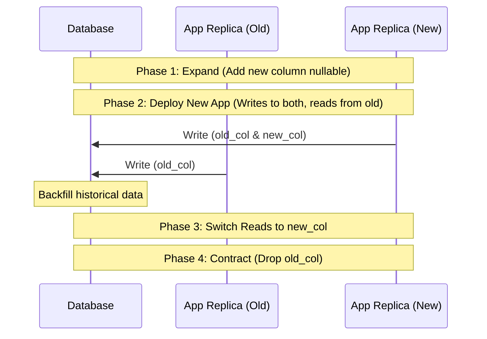

# 📘 Day 3: Database Design & ORM

> **Focus**: Architectural database modeling, ORM/Query Builder trade-offs (Prisma vs. TypeORM vs. Kysely), zero-downtime migrations (Expand/Contract pattern), ACID transactions, and solving N+1 query bottlenecks.

---

## 🎯 Topics & Learning Outcomes

### Topics / Coverage
- **ORM Trade-Offs**:
  - *TypeORM*: Active Record vs. Data Mapper, decorator-based, native NestJS support, but complex migrations and query builder quirks.
  - *Prisma*: Type-safe client, intuitive schema DSL, Rust engine, but higher memory footprint and opaque query generation under heavy loads.
  - *Query Builders (Kysely/Knex)*: Raw SQL control, near-zero overhead, type safety without ORM magic.
- **Data Modeling & Indexing**: Primary keys (UUID vs. NanoID vs. BigInt), foreign keys, unique indexes, compound indexes, and sparse indexes.
- **Zero-Downtime Migrations**: The **Expand and Contract Pattern** for rolling deployments without locking tables or breaking running replicas.
- **Transactions & Concurrency**: ACID properties, isolation levels (Read Committed, Repeatable Read, Serializable), pessimistic vs. optimistic locking.
- **Query Performance & Optimization**: N+1 queries detection, batch loading (DataLoader), query logging, and profiling using `EXPLAIN ANALYZE`.
- **Repository Boundaries & Connection Pooling**: Sizing pool minimums/maximums, handling connection timeouts, and decoupling persistence from domain logic.

### Learning Outcomes
- ✅ Plan and execute a zero-downtime database schema migration using the expand/contract strategy.
- ✅ Diagnose and eliminate N+1 queries using eager joins or batching.
- ✅ Implement atomic multi-step writes inside a managed database transaction.

---

## 🔍 What We Have Covered So Far

In our current Shortly codebase:

1. **MongoDB / Mongoose Schema Design**:
   - [`backend/src/models/url.model.ts`](../../backend/src/models/url.model.ts) and [`backend/src/models/user.model.ts`](../../backend/src/models/user.model.ts).
2. **Indexing Strategy**:
   - `shortCode`: Unique, indexed for $O(1)$ redirect lookups (`unique: true, index: true`).
   - `customAlias`: Unique and **sparse** (`sparse: true`), meaning MongoDB only indexes documents where `customAlias` is actually populated.
   - `createdBy`: Indexed foreign reference (`index: true`) to accelerate user dashboard queries.
   - `email`: Unique index on the User collection.
3. **Atomic Writes**:
   - In [`backend/src/service/url.service.ts`](../../backend/src/service/url.service.ts#L100-L115), recording a link redirect uses atomic MongoDB operators (`$inc` and `$push`) to prevent race conditions during concurrent clicks:
     ```typescript
     await Url.findOneAndUpdate(
       { shortCode },
       {
         $inc: { clickCount: 1 },
         $push: { visits: { $each: [newVisit], $slice: -100 } }
       }
     );
     ```

---

## 🛠️ How It Was Covered (Implementation Deep Dive)

### 1. Embedded Subdocument Strategy
In [`backend/src/models/url.model.ts`](../../backend/src/models/url.model.ts#L32-L48):
```typescript
const visitSchema = new Schema<IVisit>(
  {
    visitedAt: { type: Date, default: Date.now },
    ip: { type: String, default: 'Unknown' },
    userAgent: { type: String, default: 'Unknown' },
  },
  { _id: false }
);
```
*Trade-off analysis*: Storing visits embedded directly inside the `Url` document avoids a MongoDB join/lookup on every redirect. However, as clicks grow into tens of thousands, the document size approaches MongoDB's 16MB limit, degrading read performance! This demonstrates why relational modeling with a separate `visits` table or time-series collection is necessary for scale.

---

## 🚧 What Is Remaining (NestJS Architecture Target)

### 1. ORM Migration: Prisma or TypeORM in NestJS
Transitioning from MongoDB/Mongoose to a relational model (PostgreSQL) using **Prisma** or **TypeORM** for strict referential integrity and transactional safety.

### 2. Zero-Downtime Expand/Contract Migration Pattern
When migrating or refactoring schema fields (e.g., renaming `shortCode` or splitting `visits` into its own table):
1. **Expand (Phase 1)**: Add new column/table without touching old ones. Deploy code that writes to both old and new columns, reading from old.
2. **Backfill (Phase 2)**: Run a background migration script backfilling existing rows.
3. **Switch (Phase 3)**: Deploy code that reads from the new column and writes to the new column.
4. **Contract (Phase 4)**: Drop the old column in a final clean-up migration.



### 3. ACID Transactions in Multi-Step Operations
When deleting a user, or transferring link ownership, ensure all database operations succeed or rollback together:
```typescript
// Prisma Transaction Example
await this.prisma.$transaction(async (tx) => {
  await tx.url.deleteMany({ where: { userId } });
  await tx.user.delete({ where: { id: userId } });
});
```

### 4. Detecting and Eliminating N+1 Queries
In dashboard endpoints returning URLs alongside user profiles:
- *Bad (N+1)*: Fetching 50 URLs, then running 50 separate `SELECT * FROM users WHERE id = ?` queries.
- *Good*: Single `JOIN` (`include: { createdBy: true }`) or batched query using DataLoader.

---

## 📋 Actionable Implementation Guide

### Step 1: Install Prisma in NestJS
```bash
npm install prisma --save-dev
npm install @prisma/client
npx prisma init
```

### Step 2: Define PostgreSQL Relational Schema
Update `prisma/schema.prisma`:
```prisma
datasource db {
  provider = "postgresql"
  url      = env("DATABASE_URL")
}

generator client {
  provider = "prisma-client-js"
}

enum Role {
  NORMAL
  ADMIN
}

model User {
  id           String   @id @default(uuid())
  email        String   @unique
  name         String
  passwordHash String
  role         Role     @default(NORMAL)
  urls         Url[]
  createdAt    DateTime @default(now())
  updatedAt    DateTime @updatedAt

  @@index([email])
}

model Url {
  id          String   @id @default(uuid())
  originalUrl String
  shortCode   String   @unique
  customAlias String?  @unique
  userId      String
  user        User     @relation(fields: [userId], references: [id], onDelete: Cascade)
  clickCount  Int      @default(0)
  visits      Visit[]
  isActive    Boolean  @default(true)
  createdAt   DateTime @default(now())
  updatedAt   DateTime @updatedAt

  @@index([shortCode])
  @@index([userId])
}

model Visit {
  id        String   @id @default(uuid())
  urlId     String
  url       Url      @relation(fields: [urlId], references: [id], onDelete: Cascade)
  ip        String?
  userAgent String?
  visitedAt DateTime @default(now())

  @@index([urlId])
  @@index([visitedAt])
}
```

### Step 3: Run Migration
```bash
npx prisma migrate dev --name init_url_shortener
```

### Step 4: Create a Dedicated `PrismaService` Provider
Create `src/database/prisma.service.ts`:
```typescript
import { Injectable, OnModuleInit, OnModuleDestroy } from '@nestjs/common';
import { PrismaClient } from '@prisma/client';

@Injectable()
export class PrismaService extends PrismaClient implements OnModuleInit, OnModuleDestroy {
  async onModuleInit() {
    await this.$connect();
  }

  async onModuleDestroy() {
    await this.$disconnect();
  }
}
```

---

## 🧪 Self-Assessment & Verification Checklist

- [ ] Why does embedding click visits inside a single document eventually degrade database performance?
- [ ] How does an expand/contract migration prevent running pods from throwing `column does not exist` errors during a rolling update?
- [ ] Have you tested a transaction rollback by purposefully throwing an error after the first write?
- [ ] How do you verify whether an index is being used via `EXPLAIN ANALYZE`?
