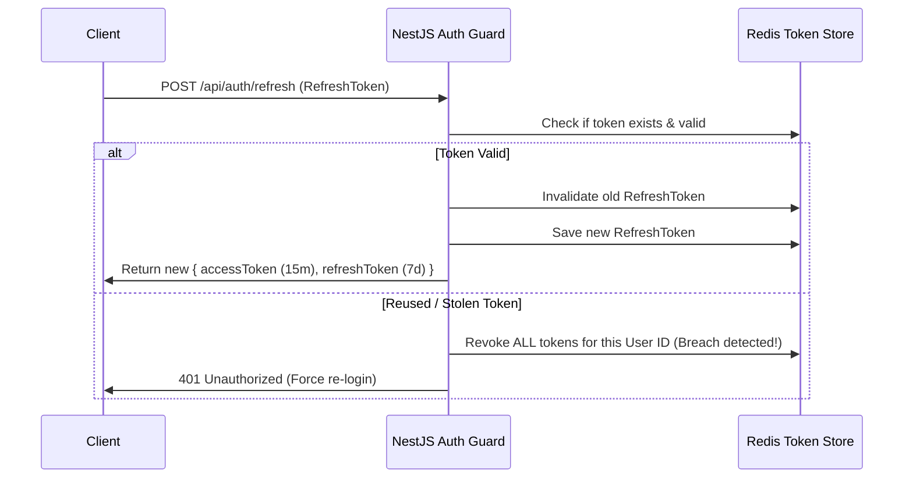

# 📘 Day 5: Authentication & Application Security

> **Focus**: Enterprise authentication patterns, dual-token rotation (Access + Refresh), Argon2 hashing, NestJS Passport strategies, fine-grained RBAC/Object-level authorization guards, and defense-in-depth security (Rate Limiting, Helmet, CORS).

---

## 🎯 Topics & Learning Outcomes

### Topics / Coverage
- **Stateful Sessions vs. Stateless JWTs**: Trade-offs in storage, horizontal scaling, invalidation, and token size.
- **Dual-Token Architecture**: Short-lived access tokens (15m) + secure rotating refresh tokens (7d) stored in Redis or DB with revocation blacklists.
- **Modern Password Hashing**: Comparing `bcrypt` vs. `argon2` (memory-hard, resistant to GPU/ASIC cracking, OWASP recommended).
- **NestJS Authentication Pipeline**: `@nestjs/passport`, `PassportStrategy`, `LocalStrategy`, and `JwtStrategy`.
- **Authorization & Access Control**:
  - *Role-Based Access Control (RBAC)*: Using `@SetMetadata` / Reflector and custom `RolesGuard`.
  - *Object-Level Authorization*: Enforcing tenant isolation (users can only edit/delete their own links).
- **Hardening the Attack Surface**:
  - Rate limiting & brute-force protection with `@nestjs/throttler`.
  - HTTP Security Headers using `helmet` (CSP, HSTS, X-Frame-Options, X-Content-Type-Options).
  - CORS policies and credentials handling.
  - Automated dependency vulnerability audits (`npm audit`).

### Learning Outcomes
- ✅ Enforce object-level ownership checks across every state-mutating endpoint.
- ✅ Implement secure refresh token rotation and revocation.
- ✅ Audit and remediate the OWASP Top 10 API Security Risks (Broken Object Level Authorization, Broken Authentication, Unrestricted Resource Consumption).

---

## 🔍 What We Have Covered So Far

In our current Shortly codebase:

1. **Password Hashing with Bcrypt**:
   - In [`backend/src/service/auth.service.ts`](../../backend/src/service/auth.service.ts), passwords are salted and hashed before persistence:
     ```typescript
     const salt = await bcrypt.genSalt(10);
     const passwordHash = await bcrypt.hash(password, salt);
     ```
2. **JWT Dual Transport (Cookie & Bearer Header)**:
   - In [`backend/src/middlewares/auth.middleware.ts`](../../backend/src/middlewares/auth.middleware.ts), auth middleware checks both `req.headers.authorization` and `req.cookies.jwt_token`.
3. **Role-Based Middleware (RBAC)**:
   - In [`backend/src/middlewares/role.middleware.ts`](../../backend/src/middlewares/role.middleware.ts), user management routes are restricted to `UserRole.ADMIN`:
     ```typescript
     export const requireRole = (requiredRole: UserRole) => {
       return (req: Request, res: Response, next: NextFunction): void => {
         if (req.user?.role !== requiredRole) {
           throw new AppError('Forbidden: Insufficient permissions', 403, 'FORBIDDEN');
         }
         next();
       };
     };
     ```
4. **Object-Level Ownership Verification**:
   - In [`backend/src/service/url.service.ts`](../../backend/src/service/url.service.ts#L65-L75), users cannot deactivate or modify URLs created by someone else:
     ```typescript
     if (url.createdBy.toString() !== userId && userRole !== UserRole.ADMIN) {
       throw new AppError('You do not have permission to modify this URL', 403, 'FORBIDDEN');
     }
     ```

---

## 🛠️ How It Was Covered (Implementation Deep Dive)

### Auth Middleware vs. Guards
In [`backend/src/middlewares/auth.middleware.ts`](../../backend/src/middlewares/auth.middleware.ts#L22-L48):
```typescript
export const authenticateUser = async (req: Request, res: Response, next: NextFunction): Promise<void> => {
  let token: string | undefined;

  if (req.headers.authorization && req.headers.authorization.startsWith('Bearer ')) {
    token = req.headers.authorization.split(' ')[1];
  } else if (req.cookies && req.cookies.jwt_token) {
    token = req.cookies.jwt_token;
  }

  if (!token) {
    throw new AppError('Authentication required. Please log in.', 401, 'UNAUTHORIZED');
  }

  const decoded = verifyToken(token);
  const user = await User.findById(decoded.id).select('-passwordHash');
  if (!user) {
    throw new AppError('The user belonging to this token no longer exists.', 401, 'UNAUTHORIZED');
  }

  req.user = user;
  next();
};
```
*Vulnerability & Limitation*: Currently, tokens have a static **7-day lifetime**. If a token is stolen or leaked, it cannot be revoked until it expires, because the backend does not track active sessions or token revoking blacklists.

---

## 🚧 What Is Remaining (NestJS Architecture Target)

### 1. Dual-Token Rotation Architecture
- Issue **Access Token (15m)** and **Refresh Token (7d)**.
- Hash and store refresh tokens in database or Redis.
- When `/api/auth/refresh` is called, verify token, revoke previous refresh token, and issue a brand-new pair (**Refresh Token Rotation**). If a used token is presented, trigger family revocation (detecting stolen tokens).



### 2. NestJS Passport Strategies & Guards
- Replace procedural middleware with `JwtStrategy` inheriting from `PassportStrategy(Strategy)`.
- Use metadata decorators `@Roles(Role.ADMIN)` with a custom `RolesGuard` utilizing `Reflector`.

### 3. Rate Limiting with `@nestjs/throttler`
- Prevent credential stuffing and DDoS on sensitive routes (`/api/auth/login`, `/:shortCode`):
  - Limit login attempts to 5 requests per minute.
  - Limit public redirects to 100 requests per minute.

### 4. Security Headers (`Helmet`)
- Add `helmet()` to set secure HTTP headers: Strict-Transport-Security, Content-Security-Policy, X-Content-Type-Options: nosniff.

---

## 📋 Actionable Implementation Guide

### Step 1: Install Security & Passport Packages
```bash
npm install @nestjs/passport passport passport-jwt passport-local
npm install @nestjs/throttler helmet argon2
npm install -D @types/passport-jwt @types/passport-local
```

### Step 2: Implement Argon2 Hashing Provider
Create `src/auth/hashing.service.ts`:
```typescript
import { Injectable } from '@nestjs/common';
import * as argon2 from 'argon2';

@Injectable()
export class HashingService {
  async hash(password: string): Promise<string> {
    return argon2.hash(password, {
      type: argon2.argon2id, // Hybrid version resistant to side-channel & GPU attacks
      memoryCost: 2 ** 16,   // 64 MB
      timeCost: 3,
    });
  }

  async verify(password: string, hash: string): Promise<boolean> {
    return argon2.verify(hash, password);
  }
}
```

### Step 3: Implement JwtStrategy
Create `src/auth/strategies/jwt.strategy.ts`:
```typescript
import { Injectable, UnauthorizedException } from '@nestjs/common';
import { PassportStrategy } from '@nestjs/passport';
import { ExtractJwt, Strategy } from 'passport-jwt';
import { ConfigService } from '@nestjs/config';

@Injectable()
export class JwtStrategy extends PassportStrategy(Strategy) {
  constructor(configService: ConfigService) {
    super({
      jwtFromRequest: ExtractJwt.fromExtractors([
        ExtractJwt.fromAuthHeaderAsBearerToken(),
        (req) => req?.cookies?.jwt_token,
      ]),
      ignoreExpiration: false,
      secretOrKey: configService.get<string>('JWT_SECRET'),
    });
  }

  async validate(payload: { sub: string; email: string; role: string }) {
    if (!payload.sub) {
      throw new UnauthorizedException();
    }
    return { id: payload.sub, email: payload.email, role: payload.role };
  }
}
```

### Step 4: Apply Rate Limiting & Helmet Globally
Update `src/main.ts`:
```typescript
import helmet from 'helmet';

async function bootstrap() {
  const app = await NestFactory.create(AppModule);
  
  // Security Headers
  app.use(helmet());
  
  // CORS Configuration
  app.enableCors({
    origin: process.env.ALLOWED_ORIGINS?.split(',') || true,
    credentials: true,
  });
  
  await app.listen(5000);
}
```

---

## 🧪 Self-Assessment & Verification Checklist

- [ ] Why is `argon2id` superior to standard MD5, SHA-256, or simple bcrypt for password storage?
- [ ] How does refresh token rotation detect when a stolen token is reused?
- [ ] Are brute-force attempts on `POST /api/auth/login` blocked with `429 Too Many Requests` after 5 attempts?
- [ ] Does your API include `X-Content-Type-Options: nosniff` and `Strict-Transport-Security` in its response headers?
