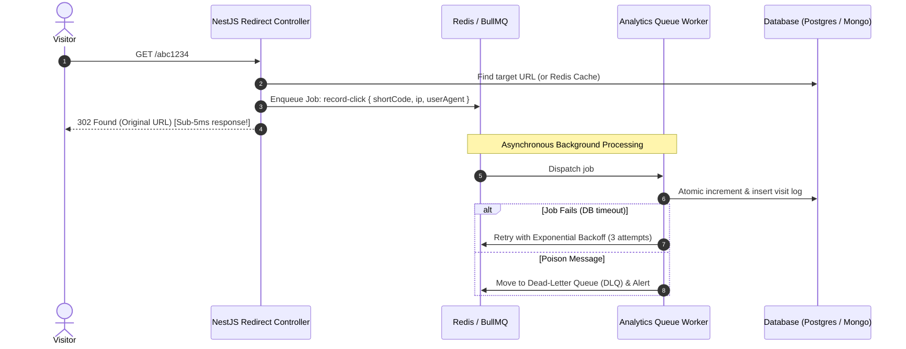

# 📘 Day 6: Background Jobs & Asynchronous Processing

> **Focus**: Decoupling latency-critical paths from background processing using message queues (BullMQ + Redis), building fault-tolerant consumers, dead-letter queues, idempotent job handlers, and distributed scheduled tasks.

---

## 🎯 Topics & Learning Outcomes

### Topics / Coverage
- **Architectural Decision Framework**:
  - *Synchronous*: When the caller requires the computed result immediately (e.g. login credentials check, token generation).
  - *Queued (Background)*: When work is essential but unneeded for the immediate response (e.g. click analytics recording, sending welcome emails, video transcoding).
  - *Event-Driven (Pub/Sub)*: When multiple independent downstream systems need to react to a domain event.
- **BullMQ & Redis Architecture**: Producers, Consumers (Workers), Queues, and Sandboxed processors.
- **Reliability & Resilience**: Exponential backoff, retry limits, handling poison messages, and routing failed jobs to Dead-Letter Queues (DLQ).
- **At-Least-Once Delivery & Idempotency**: Why distributed queues guarantee delivery at least once, and how consumers must use idempotency keys to prevent duplicate execution.
- **Distributed Scheduled Tasks (Cron)**: NestJS `@Cron` scheduler and preventing concurrent runs across horizontally scaled instances using Redlock.
- **Microservices Transport Overview**: Redis Streams, RabbitMQ, Kafka, and gRPC.

### Learning Outcomes
- ✅ Confidently identify when to offload operations from the HTTP request-response cycle.
- ✅ Implement fault-tolerant BullMQ job processors with exponential backoff and dead-letter queues.
- ✅ Build idempotent job consumers resilient against duplicate delivery.

---

## 🔍 What We Have Covered So Far

In our current Shortly codebase:

1. **Synchronous Analytics Bottleneck Identified**:
   - In [`backend/src/controllers/redirect.controller.ts`](../../backend/src/controllers/redirect.controller.ts#L18-L30), when a user requests a short link redirect:
     ```typescript
     // 1. Database read
     const url = await findUrlByCode(shortCode);
     if (!url) throw new AppError('Short URL not found', 404, 'NOT_FOUND');

     // 2. Database write on the critical request path!
     await recordVisit(url.shortCode, {
       ip: req.ip,
       userAgent: req.headers['user-agent']
     });

     // 3. Finally redirect the user
     res.redirect(302, url.originalUrl);
     ```
   - *Performance Cost*: Every redirect incurs **two roundtrips to MongoDB** before the browser receives the `302 Found` header. If MongoDB is under heavy load (e.g. 80ms latency), the visitor's redirect latency spikes from 5ms to over 100ms!

---

## 🛠️ How It Was Covered (Implementation Deep Dive)

### Analytics Service Implementation
In [`backend/src/service/analytics.service.ts`](../../backend/src/service/analytics.service.ts#L10-L40):
```typescript
export const getUrlAnalytics = async (shortCode: string, userId: string) => {
  const url = await Url.findOne({ shortCode });
  if (!url) throw new AppError('URL not found', 404, 'NOT_FOUND');
  
  return {
    shortCode: url.shortCode,
    originalUrl: url.originalUrl,
    clickCount: url.clickCount,
    lastVisited: url.visits.length > 0 ? url.visits[url.visits.length - 1].visitedAt : null,
    recentVisits: url.visits.slice(-10).reverse()
  };
};
```
*Current Architecture*: Currently, all visits and aggregations execute directly against the primary MongoDB cluster in real-time without buffering or batching.

---

## 🚧 What Is Remaining (NestJS Architecture Target)



### 1. BullMQ Queue Integration
- Integrate `@nestjs/bullmq` and connect to Redis.
- Transform redirect analytics logging into a non-blocking queue producer.

### 2. Idempotent Consumer Pattern
- Ensure that if Redis redelivers a job (e.g. due to a network glitch before worker ACK), the worker does not double-count the click.
- Deduplicate using a unique job identifier: `jobId: `${shortCode}-${ip}-${Math.floor(Date.now() / 1000)}``.

### 3. Distributed Cron Jobs with Redlock
- Clean up expired or soft-deleted URLs daily at 02:00 AM.
- If 4 pods of Shortly are running on Render or Kubernetes, ensure the cron runs **exactly once** using Redis distributed locking.

---

## 📋 Actionable Implementation Guide

### Step 1: Install BullMQ & NestJS Scheduler
```bash
npm install @nestjs/bullmq bullmq ioredis
npm install @nestjs/schedule
npm install -D @types/cron
```

### Step 2: Register Queue Module in `AppModule`
Create `src/queue/queue.module.ts`:
```typescript
import { Module } from '@nestjs/common';
import { BullModule } from '@nestjs/bullmq';
import { ConfigService } from '@nestjs/config';

@Module({
  imports: [
    BullModule.forRootAsync({
      inject: [ConfigService],
      useFactory: (config: ConfigService) => ({
        connection: {
          host: config.get<string>('REDIS_HOST', 'localhost'),
          port: config.get<number>('REDIS_PORT', 6379),
        },
      }),
    }),
    BullModule.registerQueue({
      name: 'analytics-queue',
      defaultJobOptions: {
        attempts: 3,
        backoff: {
          type: 'exponential',
          delay: 1000, // 1s, 2s, 4s
        },
        removeOnComplete: 1000,
        removeOnFail: 5000, // Keep failed jobs in DLQ for inspection
      },
    }),
  ],
  exports: [BullModule],
})
export class QueueModule {}
```

### Step 3: Implement Queue Producer in Redirect Controller
```typescript
@Controller()
export class RedirectController {
  constructor(
    private readonly urlService: UrlService,
    @InjectQueue('analytics-queue') private readonly analyticsQueue: Queue,
  ) {}

  @Get(':shortCode')
  async redirect(@Param('shortCode') code: string, @Req() req: Request, @Res() res: Response) {
    const originalUrl = await this.urlService.getOriginalUrl(code);

    // Enqueue asynchronously without awaiting worker execution
    await this.analyticsQueue.add('log-visit', {
      shortCode: code,
      ip: req.ip,
      userAgent: req.headers['user-agent'],
      timestamp: new Date().toISOString(),
    });

    // Instant redirect
    return res.redirect(HttpStatus.FOUND, originalUrl);
  }
}
```

### Step 4: Implement BullMQ Worker Consumer
Create `src/analytics/analytics.processor.ts`:
```typescript
import { Processor, WorkerHost } from '@nestjs/bullmq';
import { Job } from 'bullmq';
import { Logger } from '@nestjs/common';
import { AnalyticsService } from './analytics.service';

@Processor('analytics-queue')
export class AnalyticsProcessor extends WorkerHost {
  private readonly logger = new Logger(AnalyticsProcessor.name);

  constructor(private readonly analyticsService: AnalyticsService) {
    super();
  }

  async process(job: Job<{ shortCode: string; ip: string; userAgent: string; timestamp: string }>): Promise<void> {
    this.logger.debug(`Processing analytics for ${job.data.shortCode}`);
    
    // Idempotent execution
    await this.analyticsService.persistVisit(job.data);
  }
}
```

---

## 🧪 Self-Assessment & Verification Checklist

- [ ] Does offloading click analytics to BullMQ reduce `GET /:shortCode` response latency to under 10ms?
- [ ] If the database connection drops temporarily, does BullMQ retry the failed job with exponential backoff?
- [ ] Where do jobs go after 3 failed attempts, and how do engineers inspect and re-run them?
- [ ] If two instances of Shortly run in production, how do you prevent a nightly cleanup cron from executing twice?
