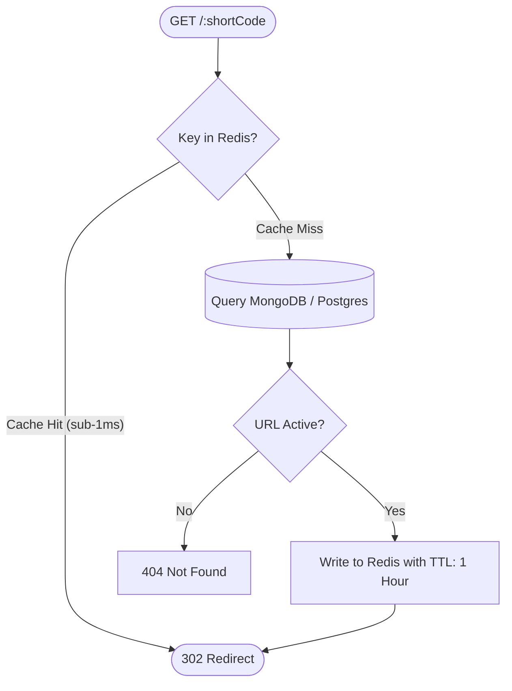

# 📘 Day 7: Performance & Scalability

> **Focus**: Node.js performance diagnostics, memory leak hunting, flame graphs, high-throughput Redis caching (Cache-Aside & Stampede Protection), Node.js Streams & Backpressure, Worker Threads, and load testing with k6.

---

## 🎯 Topics & Learning Outcomes

### Topics / Coverage
- **Runtime Profiling & Diagnostics**:
  - Profiling with `--inspect`, Chrome DevTools (`chrome://inspect`), V8 sampling profiler, and heap snapshots.
  - Flame graphs using `0x` or `clinic doctor` to visualize synchronous execution bottlenecks.
- **Event Loop Health & Memory Leak Prevention**:
  - Event loop lag monitoring (`perf_hooks` / `event-loop-lag`).
  - Common Node.js memory leak patterns (unbounded event listeners, global caches, dangling closures).
- **Enterprise Caching Strategies**:
  - **Cache-Aside (Lazy Loading)**: Read from Redis; on cache miss, query DB and populate Redis with TTL.
  - **Cache Invalidation**: Explicit invalidation on write/delete vs. TTL expiration.
  - **Cache Stampede (Thundering Herd) Protection**: Mitigating race conditions on cache expiration using probabilistic early expiration (XFetch) or distributed locks.
- **Node.js Streams & Backpressure**: Handling large file exports (e.g., CSV click logs) without exhausting memory.
- **Offloading CPU-Bound Work**: When and how to use Node.js `worker_threads` to avoid freezing the event loop.
- **Load Testing & Benchmarking**: Scripting realistic load tests with `k6` or `autocannon` to identify p95/p99 latency ceilings.

### Learning Outcomes
- ✅ Pinpoint CPU bottlenecks and memory leaks using V8 profilers and flame graphs.
- ✅ Implement a production Redis cache-aside layer with explicit cache invalidation and stampede defense.
- ✅ Stream massive datasets safely with backpressure handling.

---

## 🔍 What We Have Covered So Far

In our current Shortly codebase:

1. **Stateless Scalability**:
   - The backend avoids in-memory sessions; auth relies on JWTs, allowing horizontal replica scaling behind Render's load balancer.
2. **Selective Database Projections**:
   - In [`backend/src/service/url.service.ts`](../../backend/src/service/url.service.ts#L52), `getUserUrls` explicitly excludes the large embedded `visits` array:
     ```typescript
     await Url.find({ createdBy: userId }).select('-visits');
     ```
   - In [`backend/src/service/auth.service.ts`](../../backend/src/service/auth.service.ts), `passwordHash` is excluded from user object returns.
3. **Database Indexing**:
   - Indexed queries ensure $O(1)$ lookup for `shortCode` and $O(\log N)$ for `createdBy`.

---

## 🛠️ How It Was Covered (Implementation Deep Dive)

### Redirection Query Overhead
In [`backend/src/service/url.service.ts`](../../backend/src/service/url.service.ts#L80-L95):
```typescript
export const findUrlByCode = async (shortCode: string): Promise<IUrlDocument | null> => {
  return await Url.findOne({ shortCode, isActive: true });
};
```
*Performance Ceiling*: While indexed, every single redirect still hits MongoDB. If a short link goes viral (e.g., 50,000 requests/minute), MongoDB connections become saturated, degrading the entire application!

---

## 🚧 What Is Remaining (NestJS Architecture Target)

### 1. Redis Cache-Aside Layer for URL Redirects
Before hitting the database, check Redis (`shortly:urls:${shortCode}`). If present, redirect immediately (<1ms response time).



### 2. Cache Invalidation on Update/Delete
If a user deactivates or edits their link, immediately purge the corresponding key in Redis:
```typescript
await this.redis.del(`shortly:urls:${shortCode}`);
```

### 3. Cache Stampede Protection
When a cached key for a high-traffic link expires, hundreds of concurrent requests simultaneously hit the database to recompute the value.
- Protect against this using a Redis mutex lock (`SET key val NX EX 5`) or probabilistic early recalculation.

### 4. Streaming CSV Analytics Export
Instead of loading 100,000 visits into memory array:
- Stream MongoDB cursor directly through a `Transform` stream to `res` with backpressure.

### 5. Automated k6 Load Testing Script
Write a load test simulating 500 virtual users hammering `/health`, `/api/auth/login`, and `/:shortCode`.

---

## 📋 Actionable Implementation Guide

### Step 1: Install Redis & Cache Manager
```bash
npm install @nestjs/cache-manager cache-manager cache-manager-redis-yet
npm install -D autocannon k6
```

### Step 2: Implement Redis Cache-Aside Service
Create `src/cache/redis-cache.service.ts`:
```typescript
import { Injectable, Inject, CACHE_MANAGER } from '@nestjs/common';
import { Cache } from 'cache-manager';

@Injectable()
export class RedisCacheService {
  constructor(@Inject(CACHE_MANAGER) private readonly cacheManager: Cache) {}

  async get<T>(key: string): Promise<T | null> {
    return (await this.cacheManager.get<T>(key)) ?? null;
  }

  async set(key: string, value: any, ttlSeconds: number = 3600): Promise<void> {
    await this.cacheManager.set(key, value, ttlSeconds * 1000);
  }

  async del(key: string): Promise<void> {
    await this.cacheManager.del(key);
  }
}
```

### Step 3: Stream Large Analytics Exports with Backpressure
Create `exportVisitsCsv` in `src/url/url.controller.ts`:
```typescript
import { Controller, Get, Param, Res, UseGuards } from '@nestjs/common';
import { Response } from 'express';
import { Transform } from 'stream';

@Get(':id/export-csv')
@UseGuards(JwtAuthGuard)
async exportCsv(@Param('id') id: string, @Res() res: Response) {
  res.setHeader('Content-Type', 'text/csv');
  res.setHeader('Content-Disposition', `attachment; filename="analytics-${id}.csv"`);

  res.write('VisitedAt,IP,UserAgent\n');

  // Stream database cursor directly to HTTP response
  const cursor = this.urlModel.find({ _id: id }).cursor();

  cursor.on('data', (doc) => {
    for (const v of doc.visits) {
      const line = `"${v.visitedAt.toISOString()}","${v.ip}","${v.userAgent}"\n`;
      const canContinue = res.write(line);
      if (!canContinue) {
        cursor.pause(); // Handle backpressure
        res.once('drain', () => cursor.resume());
      }
    }
  });

  cursor.on('end', () => res.end());
}
```

### Step 4: Write k6 Load Test Script
Create `test/load/redirect-benchmark.js`:
```javascript
import http from 'k6/http';
import { check, sleep } from 'k6';

export const options = {
  stages: [
    { duration: '30s', target: 50 },  // Ramp-up to 50 users
    { duration: '1m', target: 200 },  // Steady state at 200 users
    { duration: '30s', target: 0 },    // Ramp-down
  ],
  thresholds: {
    http_req_duration: ['p(95)<10'],   // 95% of redirects must respond in <10ms
    http_req_failed: ['rate<0.01'],    // Error rate must be under 1%
  },
};

export default function () {
  const res = http.get('http://localhost:5000/demo123', {
    redirects: 0, // Don't follow 302, measure server redirect response time
  });
  
  check(res, {
    'status is 302': (r) => r.status === 302,
  });
  sleep(0.01);
}
```

---

## 🧪 Self-Assessment & Verification Checklist

- [ ] Does caching hot redirects in Redis drop average response latency from ~40ms to under 2ms?
- [ ] If you update a custom alias, is the old key immediately invalidated from Redis?
- [ ] What is the difference between V8 heap size and Resident Set Size (RSS)?
- [ ] When generating a 50MB CSV report, does memory consumption stay flat using Streams?
