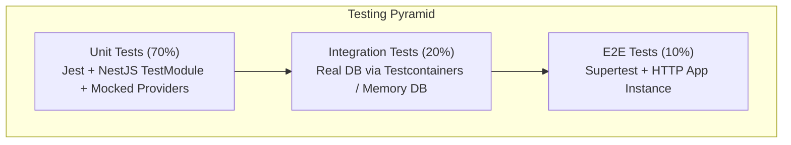

# 📘 Day 8: Testing Strategy & Quality Assurance

> **Focus**: Building a multi-tiered test pyramid (Unit, Integration, and End-to-End tests), mocking dependencies with NestJS test modules, running isolated tests against real test databases (Testcontainers), and consumer contract testing with Flutter.

---

## 🎯 Topics & Learning Outcomes

### Topics / Coverage
- **The Backend Test Pyramid**:
  - *Unit Tests (70%)*: Fast (<5ms), isolated, testing business logic with mocked dependencies.
  - *Integration Tests (20%)*: Verifying database queries, transactions, and repository layers against a real ephemeral database.
  - *End-to-End (E2E) Tests (10%)*: Testing complete HTTP request-response lifecycles with `supertest`.
- **NestJS Testing Utilities**: `Test.createTestingModule`, dependency overriding (`overrideProvider`, `overrideGuard`), and custom mock factories.
- **Database Test Isolation**:
  - In-memory databases vs. Testcontainers (Docker-based real Postgres/MongoDB).
  - Database truncation and transaction rollback patterns between tests.
- **Consumer-Driven Contract Testing**:
  - Ensuring the Flutter client (`ApiClient` with Dio) and NestJS backend never diverge on data types or nullability.
  - Validating payloads against OpenAPI schemas or Pact.
- **Code Coverage & Quality Gates**: Enforcing minimum branch and line coverage thresholds in CI.

### Learning Outcomes
- ✅ Write fast, reliable unit tests with mocked NestJS providers.
- ✅ Spin up isolated, real-database integration tests without cross-test state leakage.
- ✅ Run automated E2E tests validating security guards, pipes, and filters together.

---

## 🔍 What We Have Covered So Far

In our current Shortly codebase:

1. **Manual API Verification**:
   - Verification is currently done manually via `curl` commands:
     ```bash
     curl http://localhost:5000/health
     curl -X POST http://localhost:5000/api/auth/login -d '{"email":"...","password":"..."}'
     ```
2. **Current Project Status**:
   - As stated in [`backend/README.md`](../../backend/README.md#L70):
     > *"There is no test script yet."*
   - There are currently no test runners installed (`jest` or `vitest`) or `.spec.ts` / `.test.ts` test files.

---

## 🛠️ How It Was Covered (Implementation Deep Dive)

While functional code exists across all layers, the absence of automated tests means:
- Any refactoring (such as migrating from Express to NestJS or changing schema types) risks silent regression.
- API response contract changes can break the Flutter mobile/web client unnoticed until deployed.

---

## 🚧 What Is Remaining (NestJS Architecture Target)



### 1. Test Harness Setup
Install and configure Jest with TypeScript support (`ts-jest`), setting up `jest.config.ts` and `test/jest-e2e.json`.

### 2. Unit Testing Business Services
Test [`backend/src/service/url.service.ts`](../../backend/src/service/url.service.ts) logic:
- Verifying short code generation collision retries.
- Verifying custom alias validation throws `AppError` on reserved words.
- Verifying authorization checks throw 403 on unauthorized mutations.

### 3. Integration Testing with Ephemeral Database
Using `mongodb-memory-server` or Testcontainers PostgreSQL:
- Bootstrapping a real database.
- Seeding sample users and URLs.
- Testing real unique constraint enforcement and atomic click counter increments.

### 4. End-to-End (E2E) Test Suite
Create tests verifying the full HTTP pipeline:
- Register user ➔ Receive JWT token.
- Create URL with Bearer token ➔ Receive 201 Created.
- Access public redirect `/:shortCode` ➔ Expect 302 with correct `Location` header.
- Access protected route without token ➔ Expect 401 Unauthorized with standard error envelope.

---

## 📋 Actionable Implementation Guide

### Step 1: Install Testing Dependencies
```bash
npm install -D jest ts-jest @types/jest supertest @types/supertest @nestjs/testing mongodb-memory-server
```

### Step 2: Configure `jest.config.ts`
```typescript
import type { Config } from 'jest';

const config: Config = {
  moduleFileExtensions: ['js', 'json', 'ts'],
  rootDir: 'src',
  testRegex: '.*\\.spec\\.ts$',
  transform: {
    '^.+\\.(t|j)s$': 'ts-jest',
  },
  collectCoverageFrom: ['**/*.(t|j)s', '!**/*.module.ts', '!main.ts'],
  coverageDirectory: '../coverage',
  testEnvironment: 'node',
};

export default config;
```

### Step 3: Implement Unit Test for Custom Alias Validation
Create `src/url/url.service.spec.ts`:
```typescript
import { Test, TestingModule } from '@nestjs/testing';
import { UrlService } from './url.service';
import { BadRequestException, ConflictException } from '@nestjs/common';

describe('UrlService - Alias Validation', () => {
  let service: UrlService;

  beforeEach(async () => {
    const module: TestingModule = await Test.createTestingModule({
      providers: [
        UrlService,
        {
          provide: 'UrlRepository',
          useValue: {
            findByCode: jest.fn(),
            create: jest.fn(),
          },
        },
      ],
    }).compile();

    service = module.get<UrlService>(UrlService);
  });

  it('should reject reserved words as custom aliases', async () => {
    await expect(service.validateAlias('admin')).rejects.toThrow(BadRequestException);
    await expect(service.validateAlias('api')).rejects.toThrow(BadRequestException);
  });

  it('should reject aliases shorter than 3 characters', async () => {
    await expect(service.validateAlias('ab')).rejects.toThrow(BadRequestException);
  });
});
```

### Step 4: Implement E2E Test
Create `test/url.e2e-spec.ts`:
```typescript
import { Test, TestingModule } from '@nestjs/testing';
import { INestApplication, ValidationPipe } from '@nestjs/common';
import * as request from 'supertest';
import { AppModule } from '../src/app.module';

describe('Url Management (E2E)', () => {
  let app: INestApplication;
  let authToken: string;

  beforeAll(async () => {
    const moduleFixture: TestingModule = await Test.createTestingModule({
      imports: [AppModule],
    }).compile();

    app = moduleFixture.createNestApplication();
    app.useGlobalPipes(new ValidationPipe({ whitelist: true }));
    await app.init();

    // Login to get token
    const loginRes = await request(app.getHttpServer())
      .post('/api/auth/login')
      .send({ email: 'test@example.com', password: 'Password123!' });
    authToken = loginRes.body.data.token;
  });

  afterAll(async () => {
    await app.close();
  });

  it('/api/urls (POST) - Rejects invalid URLs with 400', () => {
    return request(app.getHttpServer())
      .post('/api/urls')
      .set('Authorization', `Bearer ${authToken}`)
      .send({ originalUrl: 'not-a-valid-url' })
      .expect(400)
      .expect((res) => {
        expect(res.body.success).toBe(false);
      });
  });
});
```

---

## 🧪 Self-Assessment & Verification Checklist

- [ ] Does `npm run test` run in under 3 seconds with mocked unit tests?
- [ ] Do integration tests wipe or roll back changes after every test case so tests never depend on run order?
- [ ] Does the E2E test assert the exact status code and JSON error envelope structure?
- [ ] Are code coverage reports generated in `coverage/lcov-report/index.html`?
