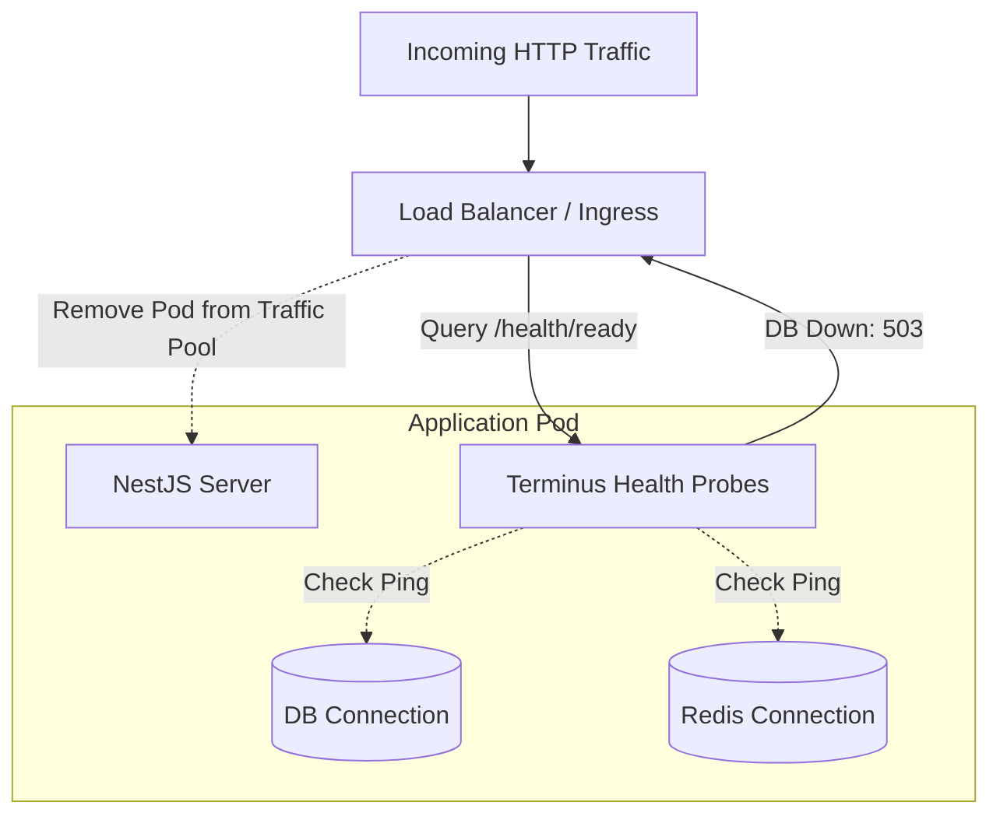

# 📘 Day 9: Observability & Production Readiness

> **Focus**: Production observability (Structured JSON logging with Pino, Correlation IDs, OpenTelemetry tracing), dual-probe health checks (Liveness vs. Readiness with Terminus), Graceful Shutdown mechanics, and hardened multi-stage Dockerfiles.

---

## 🎯 Topics & Learning Outcomes

### Topics / Coverage
- **Structured JSON Logging**:
  - Why `console.log` degrades performance (synchronous I/O) and produces unparseable logs in log aggregators (Datadog, Loki, CloudWatch).
  - High-performance asynchronous structured logging with `pino` and `nestjs-pino`.
  - Correlation IDs (`x-request-id`): Tracing a single user click across controllers, services, database queries, and background queues using AsyncLocalStorage.
- **Metrics & Distributed Tracing**:
  - Instrumenting code with OpenTelemetry (OTel).
  - Exporting Prometheus metrics (request rates, error rates, p95 latencies, event loop lag).
- **Dual-Probe Health Checks with `@nestjs/terminus`**:
  - **Liveness Probes (`/health/live`)**: Answers *"Is the Node process alive or deadlocked?"* (If failing, orchestrator restarts the pod).
  - **Readiness Probes (`/health/ready`)**: Answers *"Are DB, Redis, and queues healthy and ready to accept traffic?"* (If failing, load balancer temporarily removes the pod from the routing pool).
- **Graceful Shutdown Protocol**:
  - Listening for `SIGTERM` / `SIGINT`.
  - Stopping acceptance of new HTTP requests, waiting for in-flight requests to complete, draining BullMQ queues, and cleanly disconnecting DB pools.
- **Production Containerization**: Multi-stage Docker builds, caching `node_modules`, non-root security (`USER node`), and minimal attack surfaces.

### Learning Outcomes
- ✅ Correlate and trace any user action across logs, queries, and background workers using a single Request ID.
- ✅ Implement proper liveness and readiness probes that prevent routing traffic to unhealthy instances.
- ✅ Execute a graceful shutdown that completes in-flight requests without dropping connections.
- ✅ Build a secure, lightweight, multi-stage production Docker container.

---

## 🔍 What We Have Covered So Far

In our current Shortly codebase:

1. **Basic Health Route**:
   - In [`backend/src/app.ts`](../../backend/src/app.ts#L40-L47):
     ```typescript
     app.get('/health', (req: Request, res: Response): void => {
       res.status(200).json({
         success: true,
         message: 'Server is healthy and running',
         timestamp: new Date().toISOString(),
       });
     });
     ```
   - *Production Gotcha Documented in README*:
     > *"The server starts listening before MongoDB connects. If the database is down, `/health` still responds... A green `/health` does not prove the database is reachable."*
     This is precisely the anti-pattern resolved by separating **Liveness** from **Readiness**.
2. **Text-Based Console Logger Middleware**:
   - In [`backend/src/middlewares/logger.middleware.ts`](../../backend/src/middlewares/logger.middleware.ts):
     Outputs unstructured strings like: `[2026-10-14T11:00:00.000Z] GET /health 200 - 3.42ms`.
3. **Basic Signal Catching**:
   - In [`backend/src/server.ts`](../../backend/src/server.ts), catching `unhandledRejection` and closing the HTTP server.

---

## 🛠️ How It Was Covered (Implementation Deep Dive)

While functional for local development, current logging and health checks have critical production limitations:
- **No Correlation IDs**: When multiple users experience errors simultaneously, log messages from different requests interleave in the console, making debugging nearly impossible.
- **Unstructured Strings**: Log analysis tools (e.g. Datadog, Elastic) cannot easily query or filter string logs compared to JSON documents containing fields like `userId`, `durationMs`, and `statusCode`.
- **False Positive Health**: If MongoDB crashes or reaches connection limits, Render / Kubernetes continues routing traffic to the instance because `/health` returns `200 OK`.

---

## 🚧 What Is Remaining (NestJS Architecture Target)



### 1. Structured Logging with `nestjs-pino`
- Convert all logging to JSON format with automatic request/response duration, HTTP status, and correlation IDs injected via `x-request-id`.

### 2. NestJS Terminus Health Probes
- `/health/live`: Lightweight process ping.
- `/health/ready`: Deep health check verifying MongoDB/Postgres ping, Redis ping, and memory heap thresholds (<150MB).

### 3. Graceful Shutdown Hooks
Enable NestJS shutdown hooks:
```typescript
app.enableShutdownHooks(['SIGTERM', 'SIGINT']);
```
Ensure database connections and queue workers close cleanly during rolling redeployments.

### 4. Hardened Multi-Stage Dockerfile
Create an optimized production Dockerfile:
- Stage 1: Build TypeScript with devDependencies.
- Stage 2: Install production-only dependencies.
- Stage 3: Minimal runner with `USER node` and read-only root filesystem.

---

## 📋 Actionable Implementation Guide

### Step 1: Install Observability & Health Dependencies
```bash
npm install @nestjs/terminus nestjs-pino pino pino-http pino-pretty
```

### Step 2: Implement Terminus Health Probes
Create `src/health/health.controller.ts`:
```typescript
import { Controller, Get } from '@nestjs/common';
import { HealthCheck, HealthCheckService, MongooseHealthIndicator, MemoryHealthIndicator } from '@nestjs/terminus';

@Controller('health')
export class HealthController {
  constructor(
    private health: HealthCheckService,
    private db: MongooseHealthIndicator,
    private memory: MemoryHealthIndicator,
  ) {}

  @Get('live')
  @HealthCheck()
  checkLiveness() {
    // Fast check: process is alive
    return { status: 'ok', timestamp: new Date().toISOString() };
  }

  @Get('ready')
  @HealthCheck()
  checkReadiness() {
    // Deep check: can we serve traffic?
    return this.health.check([
      () => this.db.pingCheck('mongodb'),
      () => this.memory.checkHeap('memory_heap', 200 * 1024 * 1024), // 200MB limit
    ]);
  }
}
```

### Step 3: Configure Pino with Correlation IDs
Update `src/app.module.ts`:
```typescript
import { LoggerModule } from 'nestjs-pino';
import { v4 as uuidv4 } from 'uuid';

@Module({
  imports: [
    LoggerModule.forRoot({
      pinoHttp: {
        genReqId: (req) => req.headers['x-request-id'] || uuidv4(),
        transport: process.env.NODE_ENV !== 'production' ? { target: 'pino-pretty' } : undefined,
        autoLogging: true,
        serializers: {
          req: (req) => ({ id: req.id, method: req.method, url: req.url }),
          res: (res) => ({ statusCode: res.statusCode }),
        },
      },
    }),
  ],
})
export class AppModule {}
```

### Step 4: Multi-Stage Production Dockerfile
Create `Dockerfile`:
```dockerfile
# Stage 1: Dependencies & Build
FROM node:20-alpine AS builder
WORKDIR /app
COPY package*.json ./
RUN npm ci
COPY . .
RUN npm run build

# Stage 2: Production Dependencies Only
FROM node:20-alpine AS deps
WORKDIR /app
COPY package*.json ./
RUN npm ci --only=production

# Stage 3: Minimal Production Image
FROM node:20-alpine AS runner
WORKDIR /app
ENV NODE_ENV=production

# Security: Never run as root
USER node

COPY --chown=node:node --from=deps /app/node_modules ./node_modules
COPY --chown=node:node --from=builder /app/dist ./dist
COPY --chown=node:node package.json ./

EXPOSE 5000
CMD ["node", "dist/main.js"]
```

---

## 🧪 Self-Assessment & Verification Checklist

- [ ] What is the exact disaster that occurs if you configure your cloud load balancer to poll `/health/ready` as its Liveness probe?
- [ ] Do all log entries output valid JSON containing `req.id` matching the incoming `X-Request-Id` HTTP header?
- [ ] When you issue `kill -15 <pid>` (SIGTERM), does the server finish active HTTP requests before exiting?
- [ ] Is the final Docker container image smaller than 150MB and running under the non-root `node` user?
