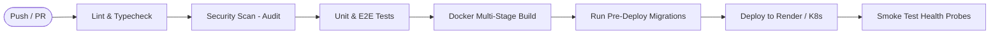

# 📘 Day 10: CI/CD, Deployment & Capstone

> **Focus**: Enterprise CI/CD pipelines with automated quality and security gates, running zero-downtime database migrations in deployment workflows, rollback and disaster recovery strategies, and the Capstone Production-Readiness Review.

---

## 🎯 Topics & Learning Outcomes

### Topics / Coverage
- **Continuous Integration (CI) Quality Gates**:
  - Enforcing non-negotiable checks before merging: Linting (`eslint`), formatting check (`prettier --check`), strict type checking (`tsc --noEmit`), unit tests (`jest`), and E2E tests (`supertest`).
  - Dependency vulnerability scanning (`npm audit`, Snyk, Trivy for containers).
- **Automated Database Migrations in Pipelines**:
  - Running migrations safely as a pre-deploy or release phase step.
  - Mitigating failed migrations without corrupting the production database.
- **Staging-to-Production Promotion & Release Verification**:
  - Automated smoke tests and canary/blue-green deployments.
  - Synthetics and post-deployment validation.
- **Disaster Recovery & Rollback Protocols**:
  - Application code rollbacks vs. Database schema rollbacks.
  - Why backward-compatible (expand/contract) migrations are the only reliable rollback strategy.
- **Capstone Production-Readiness Review (PRR)**:
  - Presenting and defending architecture, security posture, and scaling limits.

### Learning Outcomes
- ✅ Build a robust GitHub Actions CI/CD pipeline that blocks bad merges before they reach production.
- ✅ Execute safe database migrations in automated deployment pipelines.
- ✅ Formulate and execute a database-compatible rollback plan during release incidents.
- ✅ Defend backend architectural choices across all layers.

---

## 🔍 What We Have Covered So Far

In our current Shortly codebase:

1. **Production CI/CD Pipeline**:
   - Implemented in [`.github/workflows/deploy.yml`](../../.github/workflows/deploy.yml):
     - Automatically triggers on every push to `main`.
     - Validates TypeScript compilation:
       ```yaml
       - name: Install and build
         run: |
           npm ci
           npm run build
       ```
     - Triggers Render deploy hook via API and captures deployment ID.
     - Actively polls Render API in a 90-iteration loop until the deployment reports `live`.
     - Runs automated post-deploy smoke tests against the live `/health` endpoint.
     - Sequentially builds the Flutter frontend and publishes to GitHub Pages.
2. **Comprehensive Production Runbook**:
   - Documented in detail in [`DEPLOYMENT.md`](../../DEPLOYMENT.md), covering:
     - Initial setup instructions for Render, GitHub Secrets, and MongoDB Atlas.
     - Reverse proxy headers (`trust proxy`).
     - Manual redeploys and troubleshooting checklists.
     - Emergency rollback procedures in Render dashboard.

---

## 🛠️ How It Was Covered (Implementation Deep Dive)

### Deployment Workflow Architecture
In [`.github/workflows/deploy.yml`](../../.github/workflows/deploy.yml#L59-L82):
```yaml
- name: Wait for deploy to go live
  env:
    RENDER_API_KEY: ${{ secrets.RENDER_API_KEY }}
    RENDER_SERVICE_ID: ${{ secrets.RENDER_SERVICE_ID }}
    DEPLOY_ID: ${{ steps.hook.outputs.deploy_id }}
  run: |
    for i in $(seq 1 90); do
      status=$(curl -fsS \
        -H "Authorization: Bearer $RENDER_API_KEY" \
        -H "Accept: application/json" \
        "https://api.render.com/v1/services/$RENDER_SERVICE_ID/deploys/$DEPLOY_ID" | jq -r '.status')
      echo "[$i/90] $status"
      case "$status" in
        live) exit 0 ;;
        build_failed|update_failed|pre_deploy_failed|canceled|deactivated)
          echo "::error::Render deploy ended with status '$status'"; exit 1 ;;
      esac
      sleep 10
    done
    echo "::error::Timed out after 15 minutes waiting for Render"; exit 1

- name: Smoke test /health
  run: curl -fsS --retry 6 --retry-delay 10 --retry-all-errors "${BACKEND_URL%/}/health"
```
*Design Analysis*: While polling the hosting provider and running post-deploy smoke tests is production-grade, the pipeline currently lacks **pre-merge quality and security gates** (linting, automated tests, vulnerability scans) and automated database migration runners.

---

## 🚧 What Is Remaining (NestJS Architecture Target)



### 1. Pre-Merge CI Quality Gates
Split `.github/workflows/deploy.yml` or add a pull-request workflow `ci.yml` with strict gates:
- `npm run lint`
- `npx tsc --noEmit`
- `npm run test -- --ci --coverage`
- `npm run test:e2e`
- `npm audit --audit-level=high`

### 2. Automated Migration Step
When using Prisma/TypeORM, run migrations prior to activating new application code:
```yaml
- name: Run Database Migrations
  run: npx prisma migrate deploy
  env:
    DATABASE_URL: ${{ secrets.DATABASE_URL }}
```

### 3. Database Schema Rollback Strategy
- When an application release is rolled back, the database schema usually cannot simply be restored from a backup (which causes data loss for transactions created during the deploy window).
- Define backward-compatible schema principles:
  - Never rename or delete active columns in the same release.
  - All new columns must be `nullable` or have a safe `default`.
  - Maintain both versions of logic until the release is validated.

### 4. Capstone Production Readiness Review (PRR) Checklist
Prepare the architectural defense for Shortly:
- Scalability boundaries (single node vs. clustered).
- Security audit signoff.
- RTO (Recovery Time Objective) and RPO (Recovery Point Objective).

---

## 📋 Actionable Implementation Guide

### Step 1: Complete Enterprise CI/CD Workflow
Create `.github/workflows/ci-cd.yml`:
```yaml
name: CI & Production Deploy

on:
  pull_request:
    branches: [main]
  push:
    branches: [main]

jobs:
  quality-gate:
    name: Code Quality & Security Gate
    runs-on: ubuntu-latest
    steps:
      - uses: actions/checkout@v4

      - uses: actions/setup-node@v4
        with:
          node-version: 20
          cache: npm
          cache-dependency-path: backend/package-lock.json

      - name: Install Dependencies
        working-directory: backend
        run: npm ci

      - name: Strict Typecheck
        working-directory: backend
        run: npx tsc --noEmit

      - name: Dependency Vulnerability Audit
        working-directory: backend
        run: npm audit --audit-level=high

      - name: Run Unit Tests with Coverage
        working-directory: backend
        run: npm test -- --ci --coverage

      - name: Run E2E Tests
        working-directory: backend
        run: npm run test:e2e

  deploy:
    name: Production Release & Smoke Test
    needs: quality-gate
    if: github.ref == 'refs/heads/main'
    runs-on: ubuntu-latest
    environment: production
    steps:
      - uses: actions/checkout@v4

      - name: Run Database Migrations
        working-directory: backend
        env:
          DATABASE_URL: ${{ secrets.DATABASE_URL }}
        run: npx prisma migrate deploy

      - name: Trigger Render Deploy Hook
        run: |
          curl -fsS -X POST "${{ secrets.RENDER_DEPLOY_HOOK_URL }}&ref=${{ github.sha }}"

      - name: Verify Health Probes
        run: |
          curl -fsS --retry 5 --retry-delay 10 "${{ vars.BACKEND_URL }}/health/ready"
```

### Step 2: Production Readiness Review (PRR) Defense Script
Document in `PRR.md`:
1. **Capacity & Bottlenecks**:
   - Redirection throughput is protected via Redis cache-aside (expected ~15,000 req/sec per node).
   - Write volume is decoupled via BullMQ asynchronous click processing.
2. **Security Defenses**:
   - Rate limiting protects `/api/auth/login` and `/api/urls`.
   - Argon2id password hashing protects stored credentials.
   - Helmet sets strict CSP, HSTS, and frame protections.
3. **Observability**:
   - Distributed correlation IDs trace failures end-to-end.
   - Dual liveness/readiness probes prevent traffic misrouting.

---

## 🧪 Self-Assessment & Verification Checklist

- [ ] Does a pull request with a failed unit test or type error get automatically blocked from merging?
- [ ] What happens if `npx prisma migrate deploy` fails during the deployment job?
- [ ] If you need to roll back code to the previous Git SHA, why does backward-compatible schema design ensure the database doesn't crash?
- [ ] Can you defend your choice of NestJS over Express, BullMQ over synchronous writes, and Prisma over raw queries?
